

  

  

    
  

  <
    ✏️ CONTACT LINKS GO HERE. Delete the two comment lines (the opening and the closing one),
       fill in the three values, and remove any link you don't want.
  

    <a href="https://www.avneetnijjer.ca/"><code>Portfolio</code></a> ·
    <a href="https://www.linkedin.com/in/avneet-singh-nijjer/"><code>Linkedin</code></a> ·
    <a href="mailto:Nijjea1@mcmaster.ca"><code>Email</code></a>
  

  

## `~/now`


## `~/projects`

  <a href="https://github.com/Nijjea1/Aero-Surrogate"></a>
  <a href="https://github.com/Nijjea1/hotpath"></a>

  <a href="https://github.com/Nijjea1/AI-Voice-Assistant"></a>
  <a href="https://github.com/Nijjea1/HousingHub"></a>

  <a href="https://github.com/Nijjea1/Codex-Hackathon-Tamalife"></a>
  <a href="https://github.com/Nijjea1/3D-Spatial-Mapping-System"></a>

**Also built**

- [**International-Airport-System**](https://github.com/Nijjea1/International-Airport-System): airport flight data system in Python
- [**ChessGame**](https://github.com/Nijjea1/ChessGame): chess in Java
- [**BoggleGame**](https://github.com/Nijjea1/BoggleGame): Boggle in Java
- [**Wordle-Copy**](https://github.com/Nijjea1/Wordle-Copy): Wordle clone in Python
- [**nextgenpersonalportfolio**](https://github.com/Nijjea1/nextgenpersonalportfolio): personal portfolio site built with Next.js

## `~/experience`


## `~/stack`


## `~/education`


